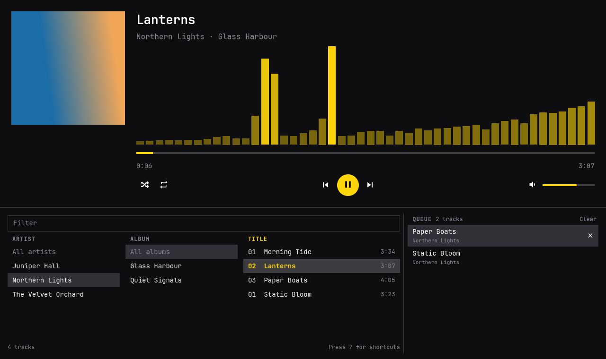

# Hum



A music player with a live spectrum visualizer, made for [Omarchy](https://omarchy.org). It plays the
files in your Music folder (MP3, FLAC, Ogg, Opus, M4A and anything else ffmpeg reads), and follows
your desktop: theme colors, font, window opacity, corner rounding and language all come from Omarchy.

## Install

```sh
git clone https://github.com/markuz83/hum && cd hum
bin/install        # builds the package and installs it with pacman
```

Hum then appears in the launcher (Super + Space). `qt6-imageformats` is optional and adds WebP cover images.

## Use

`hum` opens your Music folder (`$XDG_MUSIC_DIR`). `hum <folder>` opens another one, and
`hum <file>` opens its folder and starts that file. Press `O` to pick a folder in the window.

The library browser has three columns, Artist, Album and Title, narrowed from left to right.
Tags come from the files, and anything untagged falls back to the `Artist/Album/Title` folder layout.
Cover art is the embedded picture, or the folder's `cover.jpg`, `folder.jpg`, `front.png` and the like
(a folder with a single image uses that one). The title list shows each track's length, and hovering a
name that is cut off shows it in full.

Tracks play back to back without a gap, or with a crossfade (`C`). Hum can level loudness from ReplayGain
tags (`G`), stop after a while with a sleep timer (`T`), show lyrics (`Y`) and sort the title list (`Shift+S`).
It watches the library folder, so files you add or remove appear without reopening it.

The play queue sits to the right of the browser. Anything you add plays before the library carries on.
Drag the divider, or use `[` and `]`, to resize the two panes; double-click it or press `\` to reset.

### Keys

| Key | Action |
|---|---|
| Space | Play / pause |
| N / P | Next track / previous (restarts the track first if it is more than 3 seconds in) |
| ← → | Seek 5 seconds |
| + − | Volume up / down |
| M | Mute |
| S / R | Shuffle / repeat (with shuffle on, P goes back through what really played) |
| V | Change visualizer (bars, mirrored, line) |
| F | Visualizer refresh rate (30, 60, 120, 144, 240 Hz) |
| Y | Show the lyrics in place of the visualizer |
| Shift+S | Sort the title list: album order, title, year, recently added, length |
| G | Volume leveling: off, per track, per album (ReplayGain) |
| C | Crossfade: off (gapless), then 2 to 12 seconds |
| T | Sleep timer: 15, 30, 45, 60, 90 minutes, end of track, off |
| J K ↑ ↓ | Move in the list |
| H L Tab | Switch column |
| Enter | Play the selected track |
| / | Filter the library |
| O | Choose music folder |
| A / Shift+A | Add to queue / play next |
| X Del | Remove from queue |
| Shift+X | Clear the queue |
| Shift+J K, Alt+↑↓ | Move in the queue |
| Ctrl+Z, Ctrl+Shift+Z | Undo / redo queue changes |
| [ ] | Resize the queue pane |
| \ | Reset pane sizes |
| ? | Show every shortcut |
| Q | Quit |

Right-click a row for Play, Play next and Add to queue. The queue also takes drag and drop to reorder.

### The visualizer

The spectrum is computed from the audio actually playing (a 2048-point FFT into 48 log-spaced bands)
and smoothed the way [cava](https://github.com/karlstav/cava) does it. It updates 60 times a second;
press `F` to step through 30, 60, 120, 144 and 240 Hz. Any rate from 10 to 360 Hz can be set with `"visualizerRate"` in `~/.config/hum/state.json`.

### Gapless playback, crossfade and leveling

Hum keeps the next track loaded in a second player and starts it just before the current one ends. A player
that is already loaded still takes 10 to 80 ms to reach the speakers, so the handoff is timed with a small
margin: measured by recording the output, tracks overlap by up to about 75 ms and were not seen to leave a
gap. With a crossfade the two tracks fade equal-power across the chosen time (only for tracks at least four
times as long as the fade). Pressing next or choosing a track starts it at once.

ReplayGain is read from `REPLAYGAIN_*` tags and from Opus `R128_*` gains. A boost can only use the room
below full volume, because the audio output cannot go above full scale.

### Lyrics

`Y` shows lyrics from a `.lrc` file beside the track (synced, the current line highlighted and a click on a
line seeks to it), or from the file's lyrics tag (shown as plain text).

### Media keys, the command line and the bar

Hum speaks MPRIS, so media keys, `playerctl` and desktop widgets control it.

From a terminal or a script, with Hum running:

```sh
hum status [--json]    # what is playing
hum play | pause | toggle | stop | next | previous
hum volume [N | +N | -N]
hum seek N | +N | -N
```

Each command exits 0, or 1 with the reason on stderr (for example when Hum isn't running).

There is also an Omarchy bar widget that draws a live mini spectrum, with a progress line you can click to
seek and an optional scrolling track name. Install and enable it with:

```sh
hum plugin install --enable
```

See [omarchy-plugin/README.md](omarchy-plugin/README.md) for its controls and settings.

## Files

| Path | What |
|---|---|
| `~/.config/hum/state.json` | Volume, shuffle, repeat, visualizer, leveling, crossfade, sort, lyrics, last track and position, queue |
| `~/.cache/hum/tags.json` | Tag and length cache, keyed by file size and modified time |

Hum never changes your music files. State is saved atomically.

## Develop

```sh
bin/build          # qmake6 + make into build/hum
bin/test           # Qt Test suite, run offscreen
node --test omarchy-plugin/tests/protocol.test.js
```

Qt 6 (Quick, Material style, Multimedia with the FFmpeg backend), qmake and a C++17 compiler.
`ffprobe` reads tags and lengths. The code is in `src/`: `backend` holds the library, playback, queue and
state; `analyzer` is the spectrum; `theme` follows Omarchy; `mpris`, `barlink` and `cli` are the integrations.

## License

MIT, see [LICENSE](LICENSE).
